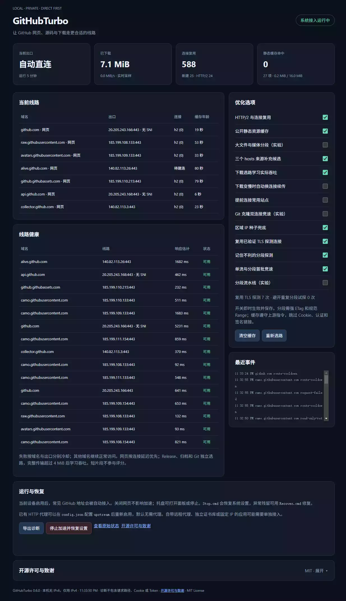

# GitHubTurbo 0.6.0

A beta-version local accelerator for GitHub on Windows. It runs independently by default, utilizing local DNS, IP optimization, HTTPS reverse proxying, and SNI-compatible strategies to improve access to GitHub web pages, raw files, static assets, releases, source code archives, and Git HTTPS operations. An optional HTTP proxy can be configured (default: `upstream: null`).

## Usage for General Users

Extract the release package to a permanent directory and double-click **Start.cmd** (or `github-turbo.exe`). Grant administrative privileges when prompted by Windows to enable the service. The setup process installs a local-only Certificate Authority (CA), configures domain routing rules for GitHub, and sets up certificates and forwarding configurations for the current user's Git/SSH environment. Once enabled, you can continue using standard GitHub URLs without needing to manually specify proxy parameters for operations like `git clone`.

Local status dashboard: <http://127.0.0.1:18080/>.

- **Stop.cmd**: Stops the engine, restores your `hosts` file and Git/SSH configurations, and removes the domain rules, trusted certificates, and recovery tasks created by the program.
- **Recover.cmd**: A standalone recovery tool to be used in the event of a startup failure or an abnormal program termination.
- **System Tray**: Double-click the icon to open the dashboard; right-click to stop acceleration and restore original settings. Closing the dashboard window does not stop the acceleration service.
- **Management Dashboard**: Allows for real-time toggling of features such as HTTP/2, public resource caching, segmented downloads, and built-in IP selection. You can also monitor connection multiplexing, network path status, and events, or export diagnostic data.
- If the engine exits unexpectedly, a native daemon process will automatically trigger a recovery. Following a power outage or system restart, recovery tasks will be executed the next time the user logs in. The acceleration service does not start automatically upon system boot.

Please keep the entire directory intact while the service is enabled—especially the `state/session.json` file. This file contains recovery records and your local private key; it should never be shared, synced, or distributed to others. It is not included in the release package.



## Default Configuration and Features

| Layer | Implementation |
| --- | --- |
| System Integration | Uses Windows NRPT to assign a local DNS for GitHub domains and subdomains; creates reversible mappings for common domains that conflict with existing `hosts` file entries. |
| Independent Resolution | Performs concurrent DNS-over-HTTPS (DoH) lookups via Cloudflare, Google, Alibaba (with additional sampling of different EDNS subnets) and DNSPod to retrieve IPv4/IPv6 addresses. Uses fixed resolver endpoints while maintaining TLS certificate validation to bypass potentially hijacked system DNS. |
| IP Optimization | Prioritizes real-time DoH results, with `hosts` entries and built-in candidates serving as latency-based fallbacks. Probes up to 8 diverse candidates per group; validates original domain certificates; prioritizes standard SNI, while connections without SNI are relegated to a lower-priority fallback tier. |
| Connection Health | Tracks latency, throughput for large responses, and failure-based cooldown periods on a per-domain and per-route basis. Handles 421, 429, 5xx, and connection errors specifically; rate-limiting responses do not trigger retries. Web-related routes are persisted locally, while download-related routes are re-evaluated upon each application launch. |
| Local HTTPS | Generates a unique, machine-specific Certificate Authority (CA). Establishes two distinct TLS segments: one from the client to the local machine, and another from the local machine to the actual GitHub server. The upstream connection always validates the certificate chain against the original hostname. |
| HTTP Forwarding | Utilizes HTTP/2 for both front-end and back-end communication, reusing previously validated TLS probe connections and sharing upstream connections for the same domain across different client sessions. Falls back to HTTP/1.1 when HTTP/2 is unsupported. Supports streaming requests/responses, `Range` requests, cookies, authentication headers, and independent HTTP/1.1 WebSocket upgrades. Enforces consistency between the `Host` header and the TLS target. |
| Connection and Cache Limits | Supports a maximum of 96 shared upstream connections across 64 connection pools. Web session pools are limited to 1 connection each, while download/Git pools are limited to 4. Web connections are reclaimed after 300 seconds of inactivity and download connections after 90. The public static cache is capped at 16 MiB (up to 128 entries, with a maximum of 2 MiB per entry); requests containing cookies, authentication tokens, or signature parameters—as well as account-specific web pages—are not cached. |
| Failure Fallback | If a `GET` or `HEAD` request returns a 5xx error, the system makes a limited number of attempts using alternative IP addresses or TLS configurations; requests containing a body or using the POST method are not automatically replayed. |
| Release | For standard downloads, if a 5xx error occurs, the system can anonymously attempt to use the official Release API. Experimental 4-way parallel Range-based downloading can be enabled manually; by default, it uses a standard single-stream connection, verifying strong ETags, Content-Range headers, and content length for each segment. Public third-party mirrors are not used. |
| Git | Standard HTTPS clone/pull/push operations are routed through a local reverse proxy. For OpenSSH, a dedicated `ProxyCommand` is configured for `github.com` and `ssh.github.com`, routing connections to the official SSH 443 endpoint. |
| Optional Upstream | Once a local HTTP CONNECT proxy is configured, it participates in the routing selection process alongside direct connections. If an upstream proxy fails, it does not affect direct connection attempts that are not explicitly assigned to use a proxy. |
| Recovery | Includes session persistence, native process monitoring, and login/recovery tasks. If no concurrent changes are detected in the `hosts` file, the program restores its previous state byte-for-byte; if changes are detected, it removes its own markers while preserving any external edits. |

Plain-text HTTP GitHub URLs are redirected to HTTPS. Local DNS resolves GitHub domain names to IPv4 loopback addresses, while the actual upstream connection can still utilize IPv6, but only once IPv6 is shown to work. The check sends nothing locally: the route must use a native global address, so Teredo, 6to4, unique-local and link-local addresses do not count. If that passes, one TCP handshake (at most 1.5 s, repeated every 30 minutes) must reach a public IPv6 resolver; until it does, only IPv4 is used. Three IPv6 connection failures in a row switch IPv6 off for 10 minutes. While it is off, no AAAA query is made and no IPv6 address is tried, including cached ones. The dashboard footer and `/status` (`ipv6`) show the current state. An HTTP/2 toggle controls upstream negotiation, and the front-end supports both HTTP/2 and HTTP/1.1.

## What's New in 0.6.0

- **Slow-connection rescue** (`flow_rescue`, on): a large download that stalls continues from where it stopped over new connections. See "Slow-Connection Rescue and Caching" below.
- **Connection warm-up** (`prewarm`, on): connections to the busiest GitHub hosts are opened at start and kept ready while in use.
- **Git clone racing** (`git_race`, off): experimental, see below.
- **`github-turbo.exe git <arguments>`**: run one git command through the engine without enabling system integration.
- **IPv6 detection**: IPv6 is used only after it is shown to work on this network, and is paused after repeated failures. Machines without IPv6 no longer send AAAA queries or IPv6 connection attempts.
- **Faster DNS-over-HTTPS**: shorter timeouts, failing providers skipped for 60 seconds, answers refreshed in the background.
- **Dashboard**: an "Open-Source Licenses and Acknowledgments" panel (folded by default, linked from the footer) and the IPv6 state in the footer.
- Release packages now include `README_zh.md`, and every bundled dependency ships with its license text.

Configuration files from 0.5.0 keep working; new options take their defaults.

## 0.5.0 Routing Adjustments

Real-time DNS-over-HTTPS (DoH) lookups are prioritized; `hosts`-based resolution and built-in fallback candidates are only initiated after a 400ms delay. Connections are established as soon as a valid resolution is obtained, while slower resolution services continue to run in the background. Candidate selection uses a distributed sampling approach to prevent IP addresses at the beginning of the list from displacing those that follow.

The system updates data hourly from [jianboy/github-host](https://github.com/jianboy/github-host), [GitHub520](https://github.com/521xueweihan/GitHub520), and [maxiaof/github-hosts](https://github.com/maxiaof/github-hosts). Only public IP addresses belonging to GitHub are accepted, and successful entries are retained for a maximum of 24 hours. Source data is not written directly to the system `hosts` file, and all connections continue to be verified against the original GitHub domain certificates. Routing for web requests is determined by connection latency; separate connection pools and path caches are used for Release, objects, codeload, and Git traffic. When initiating a download, the system first attempts the preferred DNS address, with subsequent addresses tried at 150 ms intervals—this prevents minor handshake timing variations from dictating the chosen download path. Throughput is evaluated only based on complete "200 OK" responses exceeding 4 MiB; short fragments and "206 Partial Content" responses are ignored. The system avoids previously identified "slow" paths for future requests; a transfer that falls behind can continue over new connections (see below). Path cache data from version 0.4 is invalidated; the system relearns optimal paths with each new download session. Web-related path data is cached to disk only temporarily.

New `host_sources` and `adaptive_routing` toggles have been added and are enabled by default. Learned routing data reflects actual end-to-end throughput—factoring in both the specific file being accessed and downstream read speeds—rather than representing a fixed bandwidth for a given IP address. Historical data is retained in-process for only six hours; no cookies, tokens, or signed download URLs are stored. If you switch networks, you can select "Re-route" to clear the existing cache.

Legacy static GitHub `hosts` entries may point to outdated or expired network paths. After disabling other acceleration tools, you can run the following command in an administrator-level PowerShell session:

```powershell
powershell -NoProfile -ExecutionPolicy Bypass -File .\scripts\hosts.ps1 -Action clean
```

A full backup and its corresponding SHA256 hash are saved in `state/hosts-backups`, while other existing `hosts` entries remain untouched. To restore, use the same script with the arguments `-Action restore -Backup <path_to_backup.json>`; the system will refuse to overwrite the file if it has been modified since the cleanup. This cleanup process is separate from the temporary `hosts` modifications applied during application startup or shutdown.

## Slow-Connection Rescue and Caching

On the test network, download speed turned out to be decided per connection rather than per IP. New `flow_rescue` toggle, enabled by default: an eligible download (at least 4 MiB, strong ETag, uncompressed, no client `Range`) starts as the normal single GET and adds no requests while healthy. If upstream falls under 512 KiB/s, or the connection fails, it continues from the current offset over four new connections, replacing slow ones. Output stays in order, and each Range reply must match the original ETag and the exact span. Git pack downloads cannot use this.

DNS-over-HTTPS timeouts are shorter (800 ms to connect, 1.5 s per query), failing providers are skipped for 60 seconds, and answers are kept longer and refreshed in the background. Details, measurements and limitations are in `docs/flow-rescue.md`.

## Connection Warm-Up

New `prewarm` toggle, enabled by default: when the engine starts it connects to `github.com`, `api.github.com`, `github.githubassets.com`, `avatars.githubusercontent.com` and `raw.githubusercontent.com`, sending no requests over those connections. For any of these used within the last hour it keeps one connection ready, and stops once a host goes unused. Re-route cancels all of this. Addresses this machine has no route to, such as IPv6 on a network without it, are no longer queried or probed. Reasoning and measurements are in `docs/dev-sidecar-review.md`.

## Git Clone Racing (Experimental)

New `git_race` toggle, disabled by default. A Git fetch that asks for objects is sent over two new connections to two different GitHub addresses, and whichever first delivers 1 MiB (or its whole reply) is kept; the other is closed. git always receives one complete reply. GitHub runs each fetch twice and up to 1 MiB is downloaded twice. In ten paired medium clones the results were mixed, and small clones became about 0.35 s slower, so it stays off. Details are in `docs/git-race.md`.

## One Git Command Without Setup

Without enabling system integration, you can run a single git command through GitHubTurbo, an idea taken from fgit:

```powershell
.\github-turbo.exe git clone https://github.com/OWNER/REPO.git
.\github-turbo.exe git push origin main
```

This needs no administrator rights and changes no settings: no `hosts`, NRPT, certificate or git config edits. A private engine starts on a random loopback port, and git runs with a per-command `-c http.https://github.com/.proxy=...`, which the git processes it starts inherit. The engine only chooses the GitHub address and relays the encrypted bytes, so git still checks GitHub's own certificate. Push and private repositories work as usual. If system integration is already running, git runs unchanged. git's exit code is returned; set `GITHUB_TURBO_DEBUG=1` to see engine messages. Only `https://github.com/` remotes are affected (not SSH or Git LFS object hosts), and the reverse-proxy features (HTTP/2 pooling, rescue, racing, caching) do not apply. In four paired shallow clones of curl/curl the speed difference was not reliable. Details and the fgit comparison are in `docs/fgit-review.md`.

## Optional Configuration

Edit the `config.json` file located next to the executable and restart the application for changes to take effect. For example, if you are using a local proxy:

```json
"upstream": "127.0.0.1:10808"
```

The global `mode` can be set to `auto`, `direct`, or `proxy` (note that `proxy` requires an upstream configuration). The `host_modes` parameter allows for precise overrides by hostname—for instance: `{"raw.githubusercontent.com":"proxy"}`. By default, no domains are forced through a proxy. `ip_overrides` allows for the provision of temporary candidate public IP addresses for specific domains; please do not retain outdated CDN addresses indefinitely. By default, the system prioritizes real-time DoH (DNS-over-HTTPS) lookups, while utilizing a built-in list and three external `hosts` sources as fallback options (which are activated only when necessary). During upstream TLS connections, the original hostname is always verified.

Within the `optimization` section, the following features are enabled by default: `http2`, `public_cache`, `seed_routes`, `probe_reuse`, `range_memo`, `adaptive_split`, `host_sources`, `adaptive_routing`, `flow_rescue`, and `prewarm`. The features `segmented_downloads`, `range_pipeline` and `git_race` are experimental and disabled by default. Sub-options for segmentation only take effect once segmentation is manually enabled. Settings can be modified and saved in real-time via the dashboard; requests already in progress will continue to completion. Clearing the routing configuration will also purge the cache and trigger a re-routing process.

If you only require an explicit proxy, you can set `transparent.enabled: false` in a separate configuration file and run `github-turbo.exe serve <path-to-config>`. In this mode, the software does not modify system settings, terminate client-side TLS, or rewrite the client's SNI (Server Name Indication).

## Releases and Cloning

Once enabled, you can download Releases directly via your browser or perform a standard `git clone https://github.com/OWNER/REPO.git`. The tool automatically optimizes network paths without altering repository history or file semantics.

The download script supports resume-on-interrupt (via `curl`) and optional four-way segmentation (via `aria2`):

```powershell
.\scripts\download.ps1 -Url 'actual-release-https-url' -Output '.\package.zip'
.\scripts\download.ps1 -Url 'actual-release-https-url' -Output '.\package.zip' -Aria2 'C:\Tools\aria2\aria2c.exe'
```

Built-in segmentation is designed for files—such as Release assets, objects, images, or videos—that are at least 4 MiB in size, possess a strong ETag, and are not compressed. It supports a maximum of two concurrent segments, with each segment set to 256 KiB. The original download link is preserved. The system compares the first 1 MiB of data retrieved via a single-stream download against that from a four-way segmented download. If the single-stream download finishes first, or if the segmented download fails verification or does not complete within three seconds, the system reverts to the original single-stream download. To avoid redundant probes, negative results for a specific network path and object version are cached for ten minutes. If an error occurs after the main content transfer has begun, the process is interrupted, and the downloader may attempt to resume from the point of failure. If a `Range` header is specified by the client, the request is forwarded as-is. Note that an ETag consistency check is not a substitute for a publisher-provided SHA256 hash.

Git transfers maintain the semantics of the original repository. For scenarios requiring only the latest state, users may employ `git clone --depth=1`; for large repositories, options such as `--filter=blob:none --sparse` can be used as needed. These options are not enabled by default.

## Build and Verification

Environment: Windows x64, Rust/MSVC. Release builds are statically linked against the MSVC CRT. Execution does not require Python, Go, Node, BoringSSL, or additional .NET installations. PowerShell is used solely for modifying Windows system settings during startup or shutdown. In normal operation, only the engine and a native daemon (with a system tray icon) are active; there are no persistent WebView processes. Please replace the example `aria2` paths with the actual locations on your local machine.

```powershell
cargo test --locked --target x86_64-pc-windows-msvc
cargo clippy --all-targets --locked --target x86_64-pc-windows-msvc -- -D warnings
.\scripts\build.ps1
python .\scripts\integration.py
```

To cut a release candidate, run `.\scripts\package-rc.ps1` (add `-NetworkSmoke` to also test `git ls-remote` against GitHub). It requires a clean working tree and a version in `Cargo.toml` that has no final package yet. It runs rustfmt, clippy and the tests, then writes `packages\rc\GitHubTurbo-<version>-rc.<n>-windows-x64.zip` with a `.sha256` file and a manifest of the commit and per-file hashes, and runs the packaged executable once to check it starts. RC numbers count up automatically, and existing packages are never overwritten.

The default command is `enable`; other available commands include `disable`, `recover`, `serve`, `diagnose`, `pac`, and `git <arguments>`. `init-ca` and `watch` are internal administrative commands. Configuration files located alongside the executable take precedence; when running in `serve` mode, a specific configuration file can be provided.

## Current Limitations

This is the initial version integrated with the Windows system. It has not yet undergone full validation for cross-machine compatibility, long-term stability, or installer-based deployment. The scope covers GitHub-related domains (following Windows resolution rules) and standard explicit `hosts` mappings. Please note that features such as DNS-over-HTTPS (DoH), static IP assignments, remote proxies, custom certificate stores/certificate pinning, and applications running under different user or service accounts may bypass the interception mechanism or require separate trust configuration. Firefox (which uses its own certificate store) and non-OpenSSH SSH clients require individual verification.

Custom domains for GitHub Pages are not automatically intercepted, and the tool does not proxy traffic for websites unrelated to GitHub. If ports 80, 443, or 53 are already in use by other local services, the tool will fail to initialize and will automatically revert any changes made. SSH connections utilize `ProxyCommand` and do not occupy the local SSH service port.

"Optimized" IP/TLS endpoints do not guarantee optimal throughput at all times; furthermore, the fallback mechanism cannot recover from every possible network path failure. Only downloads eligible for `flow_rescue` can move between connections mid-transfer; for anything else, including Git, resuming an interrupted download must be handled by the client itself. There is currently no disk caching for release files, and no background download queue. Fallback via official APIs is limited to public releases accessible without authentication and is subject to API rate limits.

If all direct-connection optimization attempts fail, the software—being purely local—cannot create new remote egress points; in such cases, an optional upstream proxy can be configured. The web-based dashboard displays the current operational status, but this does not guarantee that all target endpoints are verified as reachable.

Development documentation is included in the source directory: `docs/research.md` covers historical design choices, while `docs/gitport-integration.md` details the references, integration, and validation for the current version; legacy reports are also preserved. The portable package contains only the application, configuration files, usage instructions, and dependency licenses; it excludes diagnostic data from the development environment or the `state` directory. Information regarding the Apache-2.0 license and the origin of the built-in candidate data (GitPort) can be found in `third-party/gitport`.

## Real-World Benchmarking Platform

To launch the local benchmarking laboratory, double-click `bench/Start.cmd` located within the source directory or the standalone benchmarking package (default port: 18190). It utilizes dedicated ports and a private CA to benchmark various configurations—including legacy versions, current builds, direct DNS-based connections, and available GitPorts. The tool supports testing for standard web content, raw files, releases, and Git clones, with integrity verification; it generates both real-time statistics and offline reports. The testing platform requires Python 3.8+, Git, and `curl`; the standard accelerator component introduces no additional runtime dependencies.

For measurement methodologies, commands, and traffic budget details, please refer to `bench/README.md`. The specific experiments conducted in this round, along with the rationale behind various design choices, are documented in `docs/validation-0.4.md`. By default, "segmented pipelining"—which has not demonstrated consistent, tangible performance gains in public network environments—is disabled.

Version 0.4.1 addresses a regression in release testing: during a four-round test sequence using a fixed set of IP addresses, enabling segmented pipelining resulted in slower performance and a timeout; consequently, the use of segmented pipelining has been disabled by default. TLS session reuse and IP optimization remain enabled; for further details, see `docs/release-regression-0.4.1.md`.
